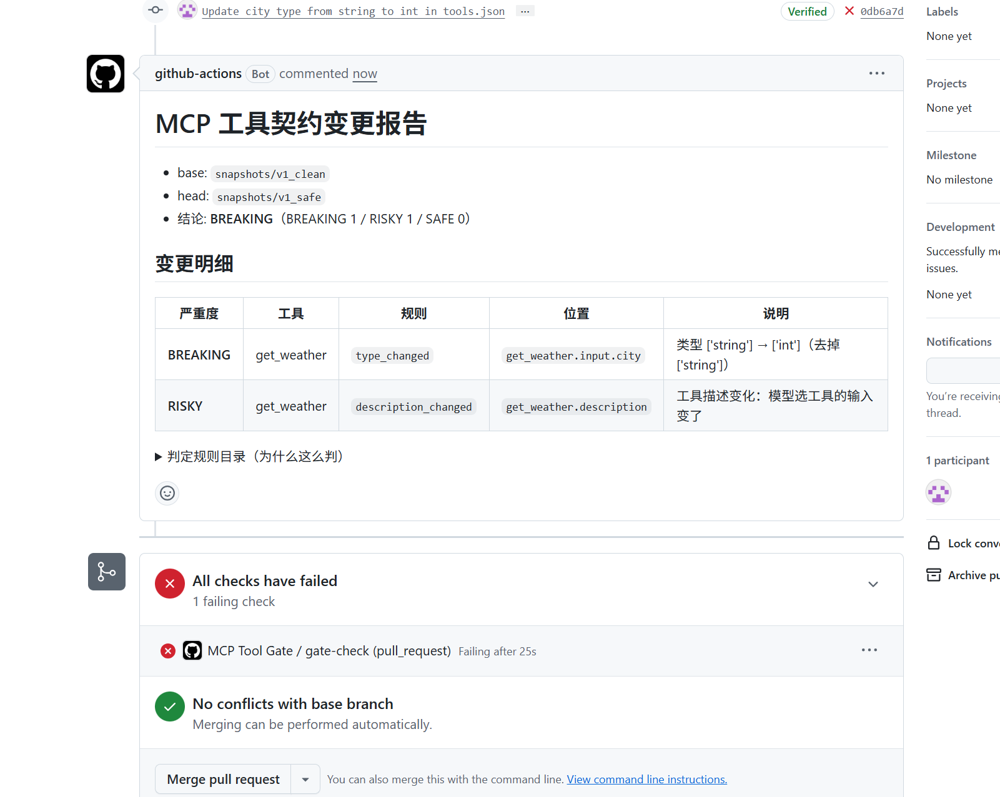
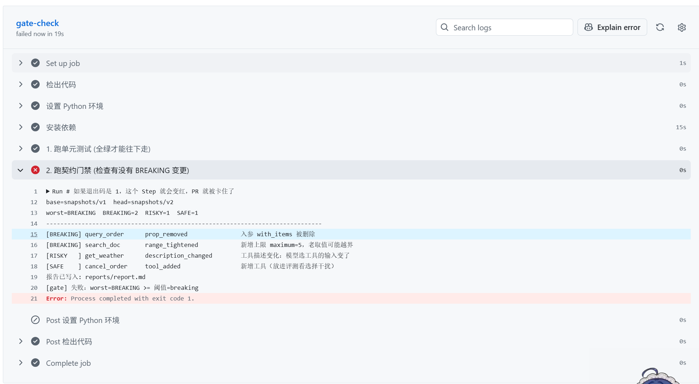
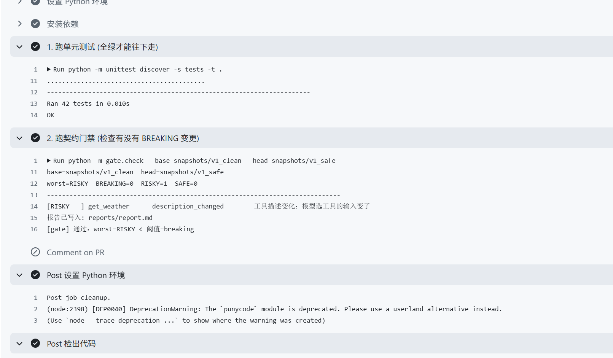
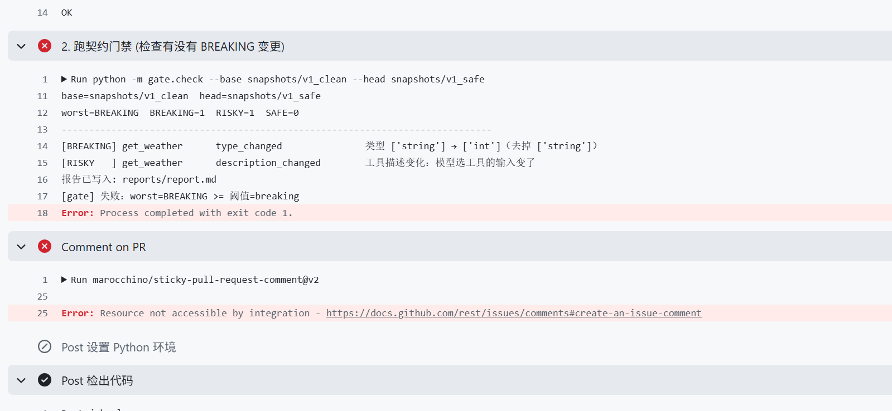

# 🛡️ MCP Tool Gate · AI 工具契约门禁 + MCP 治理层


> **门禁回答一个问题：一个按旧契约写的 Agent，在新版本的工具上还能不能跑？**
> **治理层回答另一个问题：真跑起来之后，谁在调、调了多少、有没有超限、出事了去哪查？**
>
> 前者是**合码前**的静态判定（零网络、同 commit 同结论），后者是**运行期**的 MCP 代理（限流 / 审计 / 指标）。
> 两层共用一套「工具契约」的语言：门禁保证契约不变坏，治理层保证调用可控可查。

## 😖 为什么需要它

MCP 工具就是 Agent 的"接口"。但接口改坏了，**强类型客户端会报错，LLM Agent 不会**：

| 变更 | 强类型客户端 | LLM Agent |
|---|---|---|
| 参数 `city` 从 `string` 改成 `int` | 序列化直接报错 | **不报错**：把 `"北京"` 硬塞进去，或者干脆改选另一个工具 |
| 删掉一个可选参数 | 老调用照旧，通常无感 | **工具语义变了**：模型仍然选它，但参数不再传出（实测：`slow` 删掉唯一的 `ms` 后，5 条用例的参数全错，而工具选择率反而看不出问题） |
| 新增必填参数（哪怕带 `default`） | 缺参报错 | 模型"猜"一个值填进去 → 静默错 |

所以 Agent 的失败是**静默**的，排查成本极高；必须有一层在**合码前**拦住契约变更。这就是本项目。

## ✅ 它做什么

- **快照**：连任意 stdio MCP Server，把 `tools/list` 落成可 diff 的 JSON（带 `sha256`）
- **语义 diff**：33 条规则 / 三级严重度（BREAKING · RISKY · SAFE）；`$ref` 展开、`oneOf` 归一化、**请求侧与响应侧分向判定**
- **CI 卡点**：退出码 1 卡住 PR + `report.md`（贴 PR 评论）/ `report.json`（CI artifact）
- **影响面归因**：漂移 → 自动重跑评测（LangGraph SUT）→ 报出「哪几条用例从对变错、对应哪条变更」
- **运行期治理**（`govern/`）：HTTP（`:8001/mcp`）/ stdio 双通道代理 + Redis Lua 令牌桶限流 + 脱敏审计（只存 key 列表与 sha256）+ Prometheus 指标，`docker compose up` 一条命令起 proxy + redis

## 🎬 真实场景（截图都来自本仓库的 GitHub Actions）

**① 一个普通 PR：把 `city` 从 `string` 改成 `int`**



机器人自动贴出「BREAKING 1 条 / RISKY 1 条 + 明细表 + 规则目录」，PR 变红。**人不用去读日志。**

**② 测试绿 ≠ 门禁绿**

| 门禁红（有 BREAKING） | 门禁绿（只有 RISKY） |
|---|---|
|  |  |
| `42 tests OK`，但第 6 步 `exit 1` | `worst=RISKY  BREAKING=0` → `[gate] 通过` |

**测试证明「代码没坏」，门禁证明「契约没坏」—— 两种红是两件事。**

**③ 改参数 → 门禁卡住**



## 🚀 核心战绩：从静态拦截到影响面归因

静态规则能告诉你"这里有破坏性变更"，但说不清**影响多大**。本项目用真实的 LangGraph Agent 跑评测，把变更翻译成业务损失：

```text
=== 影响面归因报告 ===
基准版本: real-v1 | 对比版本: real-v2
工具选择准确率: 87.78% -> 95.56% (Δ +7.78 pp)
参数填写准确率: 92.40% -> 75.57% (Δ -16.83 pp)
受影响的具体用例: c07, c12, c20, c24, c28
对应变更原因: slow.prop_removed (BREAKING)
```

一句话读法：**删掉 `slow.ms` 这唯一的入参，参数准确率掉 16.83 个点，5 条用例从"每轮全对"变成"每轮都错"**。更值得看的是：这 5 条**全都还把 `slow` 选对了**，只是没地方填"500 毫秒"——`both_acc` 从 81.11% 掉到 72.22%。选错工具一眼能看出来，参数悄悄丢才是最难查的那类失败。

> 注意 `tool_acc` 反而 **+7.78pp**。单轮噪声约 ±8pp，同一份契约重跑也会漂，这个数不能当提升；工具集里还多了 `health_check` 这个干扰项。**这正是"只看总分会被骗"的证据**，也是为什么三个分数要分开报。
>
> 数字来自 `reports/impact.md`（30 条 case × 3 轮），复现命令见下面的「快速开始」。

## 🛡️ 治理层（govern/）：契约之外，运行期的那一层

门禁管的是**合码前**的静态契约；治理层管的是**跑起来之后**的调用。

```text
Agent ──MCP(HTTP :8001/mcp 或 stdio)──▶ govern/proxy.py
                                          ├─ ① 令牌桶限流（Redis + Lua，原子扣减）
                                          ├─ ② 脱敏审计（只存 args_keys + sha256）
                                          ├─ ③ Prometheus 指标（:8000/metrics）
                                          └─ ④ 原样转发 ──stdio──▶ 上游 MCP Server
```

| 能力 | 实现方式 | 怎么验证 |
|---|---|---|
| 原样透传 | 用 lowlevel `Server`：`list_tools` 直接返回上游 `Tool`，`call_tool` 直接返回上游 `CallToolResult`（`content` 与 `structuredContent` 都不改写） | rich 靶场直连 / 过代理各抓一份快照，`sha256` 相同；带 `outputSchema` 的工具 `structuredContent` 不为空 |
| 双通道 | 默认 HTTP（`streamable-http`，`:8001/mcp`）；`--transport stdio` 留给 bench / snapshot / 旧客户端 | `python test_http_client.py`；`python -m gate.snapshot --server govern/proxy.py --extra-arg=--transport --extra-arg=stdio --out snapshots/via-govern` |
| 限流 | Redis Lua 令牌桶（原子扣减），`burst / rate / interval` 可配；Redis 异常按 `fail-open` / `fail-closed` 降级 | 开限流后 6 并发打同一工具，预期 5 过 1 拒；两个租户互不影响 |
| 审计 | `asyncio.create_task` 异步落库 + `asyncio.Lock` 串行化（绕开 SQLite 写锁），只存参数 key 列表与 sha256 | `select * from tool_audit` 看不到明文 |
| 指标 | `prometheus_client`，`:8000/metrics` 暴露调用数 / 耗时 / 在飞并发 / 限流拒绝数 | `curl.exe :8000/metrics` |
| 部署 | `Dockerfile` + `docker-compose.yml`（govern + redis），映射 8000（指标）与 8001（MCP） | `docker compose ps` 两个容器 Up |

**为什么代理不用「自定义 HTTP 接口」**：Agent 只会说 MCP 协议（`langchain-mcp-adapters` 等），所以治理层必须对下游"就是一个 MCP Server"、对上游"就是一个 MCP Client"，把治理插在中间，而不是另发明一套 API。

**诚实边界（现在的真实状态）**：

- 限流默认关闭（`ratelimit_enabled=false`）；演示要显式设 `GOVERN_RATELIMIT_ENABLED=true`，且 Redis 不可达 + `fail-open` 时会全部放行。
- 治理只覆盖 `tools/list` 与 `tools/call`；`resources` / `prompts` 还没走同一道闸（路线 B 的 ASGI 中间件才能全覆盖）。
- 审计是后台任务，进程被 kill（`SIGTERM`）时最后几条可能丢，优雅停机还没做。
- `alembic/` 里仍是空迁移，建表实际靠启动时的 `create_all`（P1-6 待办）。
- 多客户端共享同一条上游 stdio 连接，并发行为还没压测过。

## ⚡ 快速开始

门禁链路零外部服务；评测需要 `DEEPSEEK_API_KEY`；治理层需要 Docker（或本地 Redis）。

```powershell
pip install -e .            # 或 uv sync

# 1) 抓快照：连 MCP Server 的 tools/list，落盘 + sha256
python -m gate.snapshot --server examples/demo_server.py --out snapshots/v1

# 2) 把契约改坏，生成 v2（删参 / 收紧范围 / 改描述 / 加工具）
python examples/break_it.py

# 3) 门禁判定：退出码就是 CI 卡点
python -m gate.check --base snapshots/v1 --head snapshots/v2     # exit 1

# 4) 评测 + 影响面归因（需要 DEEPSEEK_API_KEY，见 .env.example）
python -m gate.eval   --cases cases/tool_selection.json --sut real --rounds 3 --snapshot snapshots/real-v1
python -m gate.impact --base snapshots/real-v1 --head snapshots/real-v2
```

`--sut fake` 是**管线自检**（读 `cases/fake_answers.json`，应恒为 100%）：不花钱，也不代表模型能力；它一跌破 100%，说明坏的是评测管线而不是模型。

### 治理层（proxy + redis）

```powershell
pip install -e ".[govern]"           # 治理层依赖（uvicorn / starlette / sqlalchemy / redis / prometheus…）
docker compose up -d --build         # govern + redis；8000=指标，8001=MCP
python test_http_client.py           # 握手 + 拉工具 + 验证 structuredContent
curl.exe http://127.0.0.1:8000/metrics

# 想在本地跑，先把容器停掉（否则 8000/8001 被占）
docker compose down
python govern/proxy.py               # 默认 HTTP :8001；端口可用 GOVERN_HTTP_PORT 覆盖
python bench/bench.py                # 内部走 --transport stdio，做直连 vs 代理的 p95 对照

# 限流演示：先以开启限流的方式启动，再另开一个终端跑租户脚本
$env:GOVERN_RATELIMIT_ENABLED="true"; python govern/proxy.py
python test_tenant_limit.py          # A/B 各 5 过 1 拒
```

## 🧠 判定引擎：五条设计判断（面试会追问）

1. **`$ref` 必须展开后再比** —— 只比 `"$ref": "#/$defs/Tool"` 这个字符串，会漏掉内层 `type` 的变更。
2. **`oneOf` 的顺序没有语义** —— 不归一化就会把"换个顺序"误报成 BREAKING；而**误报一次，团队就会把门禁关掉**。
3. **请求侧和响应侧方向相反** —— 入参"收紧"（删参 / 加 required / 缩 enum）是破坏；出参"放宽"（扩 enum / 删字段）才是破坏。
4. **没写 `enum` / `type` / `items` 等于"不限"** —— 所以"从无到有"恰恰是收紧。第一版只比了"两边都存在"的键，真实靶场注入 6 处只检出 5 处（`boom.reason` 新增 enum 被静默放过）；修完才是 **6/6**。
5. **`default` 不是兼容性保证** —— 新增 `required` 即使带默认值也判 BREAKING：`default` 是服务端兜底，不是契约。

> 为什么判定层**不用 LLM**：门禁跑在 CI 里，同一个 commit 必须每次结论一致、零网络、零成本。
> 用 LLM 判"破不破坏"会出现两次跑出两个结果——这种门禁没人敢用。**LLM 只出现在被测对象（SUT）里。**

## 📊 评测口径：三个分数，不是一个

| 指标 | 定义 | 什么时候看它 |
|---|---|---|
| `tool_acc` | 工具选对 / n | 选错工具 = 没理解意图 → 改工具 description |
| `args_acc` | 参数填对 / **工具选对**（条件口径） | 分母不是 n：工具都选错时"参数恰好对"是运气 |
| `both_acc` | 一次调用整体正确 / n | 端到端可用率 |

每条 case × **3 轮**（当前 30 条：20 条基础 + 10 条"一句话同时沾两个工具"的歧义用例），报 `mean [min, max]`：**单轮噪声约 ±8pp，比要检测的退化还大**，所以不看单轮数字。
`--sut fake` 只做管线自检；`--sut real` 才是真分数（LangGraph SUT，代码在 `sut/agent.py`）。

## 🧩 架构

```text
 MCP Server ──tools/list──▶ gate.snapshot ──▶ snapshots/<name>/tools.json  (提交进 git，可 review)
                                                     │
 PR 改了工具 ──tools/list──▶ gate.snapshot ──────────┤
                                                     ▼
                                          gate.diff + gate.rules（纯确定性，零网络）
                                                     │
                          ┌──────────────────────────┼──────────────────────────┐
                          ▼                          ▼                          ▼
                 reports/report.md           退出码 1（CI 卡点）        gate.eval（LangGraph SUT）
                 reports/report.json                                     │ 三分数 × 3 轮
                                                                         ▼
                                                                 gate.impact（Δ + 受损 case + 原因）
```

运行期（治理层，与门禁正交）：

```text
 Agent ──MCP(HTTP :8001/mcp 或 stdio)──▶ govern/proxy.py ──┬─ 限流（Redis Lua 令牌桶）
                                                            ├─ 审计（脱敏 → SQLite）
                                                            ├─ 指标（:8000/metrics）
                                                            └─ 转发 ──stdio──▶ 上游 MCP Server
```

## 📁 目录结构

```text
mcp-tool-gate/
├─ gate/snapshot.py       # 连 MCP Server 取 tools/list，落盘 + sha256
├─ gate/diff.py           # 心脏：$ref 展开 / oneOf 归一化 / 请求响应分向
├─ gate/rules.py          # 33 条规则表（纯数据，每条带"为什么这么判"）
├─ gate/check.py          # CLI：报告 + 退出码
├─ gate/eval.py           # 评测：三分数 + 多轮区间（条件口径）
├─ gate/impact.py         # 漂移 → 受损 case → 对应 finding
├─ govern/proxy.py        # 治理层入口：HTTP(:8001) / stdio 双通道 + metrics(:8000)
├─ govern/app.py          # lowlevel Server：原样透传 + 租户解析 + 限流 + 审计
├─ govern/ratelimit.py    # Redis Lua 令牌桶（fail-open / fail-closed）
├─ govern/audit.py        # 脱敏审计（args_keys + sha256），SQLAlchemy async
├─ govern/metrics.py      # Prometheus：调用数 / 耗时 / 在飞并发 / 拒绝
├─ sut/agent.py           # 被测对象：手搭的 LangGraph 图（StateGraph + ToolNode）
├─ cases/                 # 30 条 case（20 基础 + 10 歧义）+ fake 答案表（管线自检基线）
├─ examples/              # demo server / rich 靶场 / 改坏脚本 / 真实靶场注入
├─ snapshots/             # v1·v2（假靶场）、real-v1·real-v2、rich-*（透传对照）
├─ tests/                 # 72 个用例：diff/check/eval/impact/rules + govern e2e/透传
├─ bench/bench.py         # 直连 vs 过代理 的 p95 对照（stdio）
├─ Dockerfile / docker-compose.yml    # govern + redis，映射 8000/8001
├─ alembic/               # 审计表迁移（目前是空迁移，建表走 create_all）
├─ docs/                  # CI 截图（images/）+ 手册与评审文档（*.md 目前未入库）
```

## 🧪 测试

```powershell
python -m unittest discover -s tests -t .     # 72 passed
```

**负例比正例重要**：`oneOf` 换序、范围放宽、`title` 改名、快照未变、`nullable` 放宽、去掉 `enum`、输出 schema 换个等价写法（`allOf` 包一层 / 单元素 `type` 数组）—— 这些都必须"不报警"。门禁误报一次，团队就会把它关掉。

## 🔁 接入你自己的仓库

```yaml
- name: 抓当前契约
  run: python -m gate.snapshot --server <你的 MCP server> --out snapshots/current
- name: 契约门禁
  run: python -m gate.check --base snapshots/baseline --head snapshots/current
  # exit 1 = 有 BREAKING → PR 变红
```

> 本仓库的 CI 为了稳定演示，比的是两份已提交的快照（`v1_clean` → `v1_safe`）；真实接入必须先跑 `gate.snapshot` 抓一份 `current`，否则门禁只会对着历史文件自说自话。

退出码语义：`0` 通过 / `1` 达到阈值 / `2` 快照缺失或参数错误。
阈值可调：`--fail-on risky` 会把 RISKY（如描述变更）也算作失败 —— 建议先只卡 `breaking`，等团队信任了再收紧。

## ⚠️ 已知限制与取舍（被问到就直说）

- 评测 30 条 case 里已有 10 条歧义用例，但**工具池仍只有 4 个**（add/echo/boom/slow）→ 工具选择难度仍低于真实场景（20+ 工具、描述高度相似）
- 语义等价只做到"**写法级**"：`allOf` 包一层、单元素 `type` 数组、空 `required`、元数据变化都不会误报；但 **`format` 的等价**（`date` vs `date-time`）和自定义类型仍转人工 review
- 分数会抖：`--rounds 3` 只能把标准误压到约一半，**±5pp 以内的差异不要当成提升或退化**
- 只比 `input_schema` / `output_schema`，不比 examples / annotations
- 治理层提供 **HTTP（`:8001/mcp`）与 stdio（`--transport stdio`）双通道**，容器映射 8000（指标）+ 8001（MCP）；治理范围只到 `tools/list` / `tools/call`，`resources` / `prompts` 未覆盖
- 代理已是**原样透传**（lowlevel Server，rich 靶场直连/过代理 `sha256` 相同，`structuredContent` 保留）；代价是它不再帮你修 schema，上游什么样就暴露什么样
- 限流默认关闭（`ratelimit_enabled=false`，compose 也没开）；审计是后台任务，进程被 kill 会丢尾部几条
- `alembic/` 里只有一条**空迁移**，建表实际靠启动时的 `create_all` —— 迁移目前只是占位
- `docs/*.md` 被 `.gitignore` 忽略，克隆下来只剩 CI 截图；三份手册在本地保留，别当它们已入库

## 🗺️ 下一步

- [x] `per_case` 改成多轮聚合率（口径统一，`impact.py` 按"以前每轮全对 → 现在有错"判定）
- [x] `impact.py` 加版本一致性校验（`report.json` 与本次 eval 不是同一对 → 报警并跳过归因）
- [x] case 补到 30 条，加入 10 条"一句话同时沾两个工具"的歧义用例
- [x] `outputSchema` 的**写法级**语义等价归一化（`allOf` / 单元素 type / 空 required / 纯元数据）
- [x] 用 30 条 case 重跑真实评测，刷新上面的数字
- [x] 治理层 HTTP 化：`streamable-http` + 租户头（`X-Tenant-Id`）
- [x] 双通道：`--transport stdio` 保留给 bench / snapshot；默认 HTTP
- [x] 代理原样透传：`list_tools` / `call_tool` 都不改写 schema 与 `structuredContent`
- [x] 修 `diff` 的漏判（`additionalProperties` 为 schema / tuple `items` / 布尔 schema）与非法数值边界的崩溃
- [ ] 429 / JSON-RPC 错误体、优雅停机、Alembic 真实迁移等 P 系列（见 `docs/改进路线图.md`）
- [ ] CI 加「抓真实 `tools/list` → 比对 baseline」这一步
- [ ] `format` 与自定义类型的语义等价（需要领域知识，暂留人工）

## 🙏 参考与致谢

判定规则的思路来自 [oasdiff](https://github.com/tufin/oasdiff)（三档严重度）与 [openapi-diff](https://github.com/OpenAPITools/openapi-diff)（45 条 incompatible 枚举）；
MCP 协议与客户端来自官方 [python-sdk](https://github.com/modelcontextprotocol/python-sdk)；
评测口径（三分数分离、多轮采样）参考 [deepeval](https://github.com/confident-ai/deepeval) 的 `MCPUseMetric` 与读数实验。
